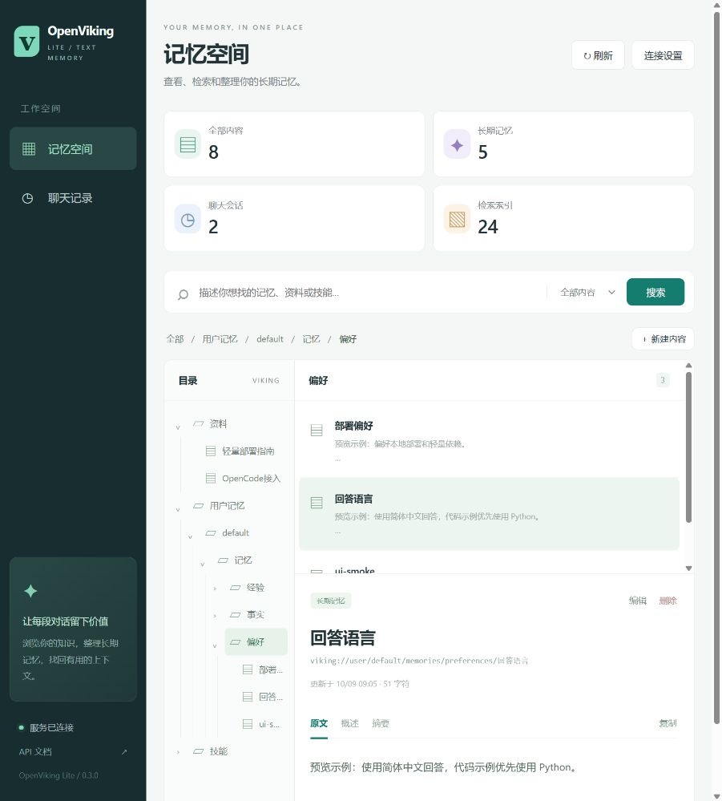

# OpenViking Lite：本地纯文本版

只部署一个本地小向量模型，接入一个通用文本模型 API，即可使用文本知识库和会话记忆。
这是独立的轻量运行版，仓库地址为 <https://github.com/zza1211/openviking-lite>。
在仓库根目录执行 `pip install -e .` 即可安装，无需拉取或安装上游完整项目。
设计参考 [OpenViking](https://github.com/volcengine/OpenViking)，本仓库只包含纯文本轻量实现。

## 改造范围

| 项目 | 本版本 |
| --- | --- |
| 向量模型 | FastEmbed + CPU ONNX，默认 `BAAI/bge-small-zh-v1.5`，512 维 |
| 文本模型 | 一个 OpenAI 兼容 `/chat/completions` API，负责摘要、问答、记忆提取 |
| 存储 | 一个 SQLite 文件，自动建表，WAL 事务；无需独立数据库 |
| 内容组织 | `viking://resources/`、`viking://user/<用户>/memories/`、`viking://skills/` |
| 分层读取 | 每份资料的 L0 摘要、L1 概述、L2 原文；长文分块并生成归并摘要 |
| 检索 | CPU 余弦相似度、URI 子树范围、每份资料去重、可选层级和分数阈值 |
| 会话记忆 | 会话持久化、增量提交、记忆提取、相同文本去重、失败不推进提交进度 |
| OpenCode 接入 | 自动记录原始聊天、后台提取记忆、回答前召回，已实测 OpenCode 1.18.30 |
| Web 界面 | 随服务提供目录浏览、内容搜索/新建/编辑/删除、会话记录与服务状态；零前端依赖 |
| 导入 | UTF-8 文本、Markdown、JSON/YAML、代码等；目录保留相对路径 |
| 多模态 | 不支持图像、音频、视频、扫描件、OCR，也不会调用视觉模型 |
| 运行依赖 | FastAPI、Uvicorn、HTTPX、NumPy、FastEmbed；无 Torch、Transformers、厂商 SDK |
| 编译 / 外部服务 | 无 Rust/C++ 源码构建、AGFS、远程向量库、爬虫、Bot、重排模型 |

默认模型的 FastEmbed 元数据标示模型体积约 **0.09 GB**，不是整个 Python 环境的大小。
FastEmbed 包会安装 ONNX Runtime、tokenizers 等传递依赖（包含 Pillow），但运行路径只加载文本模型。
不需要 GPU，不需要再启动 Ollama 或一个独立向量服务。

本版本保留核心使用流程，**不是原版 SDK/插件的完全兼容实现**。使用下面的 `openviking_lite.Client`
或 Lite HTTP 接口。不会迁移原版 AGFS/向量库数据；已有资料需要重新导入。
原版多租户权限、语义记忆合并、Agent 规划检索、任务队列、Git/网页抓取、Web Studio、MCP/原版插件未纳入本版本。
`search` 和 `find` 是同一种直接向量检索，不会额外调用规划模型。

## OpenCode 自动记忆

0.2.0 新增独立 OpenCode 适配插件。启动本服务后，在仓库根目录执行：

```bash
node integrations/opencode/install.mjs --global
```

安装后配置 `~/.config/opencode/openviking-lite.json` 的 `url`、`api_key`、`user_id`，
完全重启 OpenCode，即可在普通聊天中自动记录、提取和召回记忆。
无需手动调用 `create_session` / `commit_session`，也不会额外部署模型。
详见 [OpenCode 插件安装、配置与验证](integrations/opencode/README.md)。

## 记忆文件系统 Web UI

0.3.0 新增内置轻量界面。按下面的部署步骤启动服务后，直接访问
**<http://127.0.0.1:1933/>**，或 `/ui/`。不需要 Node.js、前端构建或额外服务。

- 树状浏览资料、用户记忆和技能，查看原文、概述与摘要。
- 描述你要找的内容进行语义搜索，可限定用户记忆、资料、技能或当前目录。
- 新建、编辑和删除单条内容；保存后自动更新向量索引。
- 查看 OpenCode/应用会话，按用户筛选、分页浏览原始聊天与记忆提取进度。
- 显示内容、记忆、会话、检索块数量，以及当前模型和服务版本。

若服务设置了 `server_api_key`，在页面的“连接设置”填写同一个 Key。
页面只连接当前服务；可选择仅在当前标签页的 `sessionStorage` 记住 Key。
静态页面可直接加载，所有数据和修改接口仍需要鉴权。

编辑默认使用原文开头作为摘要，不调用文本 API；勾选“调用文本模型生成摘要和概述”才会调用。
编辑时保留内容类型和创建时间，并检查更新时间，避免覆盖后台或其他窗口的新修改。
删除需要确认，界面只删除单条内容，不递归删除目录；删除后无法在界面撤销，操作前可按下文备份。
会话记录只读。新产生的记忆或聊天可点击“刷新”查看。
内容以纯文本显示，不执行记忆、资料或聊天里的 HTML/脚本，不加载外部字体或前端 CDN。

界面预览（示例数据）：



## Windows 本地部署

以下命令在 PowerShell 中执行。也可使用本机已经准备好的 `D:\code\memory\openviking-lite`。
需要 Python 3.10+，建议 Python 3.11 或 3.12。

```powershell
git clone https://github.com/zza1211/openviking-lite.git
cd openviking-lite
python -m venv .venv
.\.venv\Scripts\python.exe -m pip install -e .
Copy-Item config.example.json config.local.json

# 替换为你的文本 API 信息，api_base 填 API 根地址，不含 /chat/completions。
$env:MODEL_API_BASE = 'https://your-model-api.example/v1'
$env:MODEL_NAME = 'your-text-model'
$env:MODEL_API_KEY = 'your-api-key'

# 首次下载约 90 MB 的中文向量模型，并执行一次真实 CPU 推理。
.\.venv\Scripts\ov-lite.exe download-model --config config.local.json

# 可选：同时验证你提供的文本 API（会发送一次小请求）。
.\.venv\Scripts\ov-lite.exe check --config config.local.json --llm

# 启动单进程服务，默认只监听本机 127.0.0.1:1933。
.\.venv\Scripts\ov-lite.exe serve --config config.local.json
```

Web 界面：<http://127.0.0.1:1933/>；API 文档：<http://127.0.0.1:1933/docs>。
服务启动后模型会在第一次导入/查询时加载。仅浏览已有目录、内容和聊天不需要调用任何模型。
`/health` 只确认服务在运行；模型是否可用要用 `check --llm` 验证。

`${MODEL_API_BASE}` 等变量支持在 JSON 字符串中替换；缺少变量会报错。
你也可以在 `config.local.json` 里直接填值，该文件已被 Git 忽略。
无鉴权的本地文本 API 可将 `api_key` 填成空字符串，或把 `MODEL_API_KEY` 设为空字符串。
“通用 API”在这里指兼容 OpenAI Chat Completions 的接口，并非任意厂商的原生协议。
API 不必支持视觉、工具调用或 `response_format`，但必须能按提示输出有效 JSON。
摘要/记忆返回错误或截断的 JSON 时操作失败，已有数据不受影响；可以调整 API 模型或 `max_tokens` 后重试。

## Linux / macOS

在仓库根目录执行：

```bash
git clone https://github.com/zza1211/openviking-lite.git
cd openviking-lite
python3 -m venv .venv
.venv/bin/python -m pip install -e .
cp config.example.json config.local.json
export MODEL_API_BASE='https://your-model-api.example/v1'
export MODEL_NAME='your-text-model'
export MODEL_API_KEY='your-api-key'
.venv/bin/ov-lite download-model --config config.local.json
.venv/bin/ov-lite check --config config.local.json --llm
.venv/bin/ov-lite serve --config config.local.json
```

已有 uv 的用户也可在仓库根目录执行 `uv sync --locked`，然后用 `uv run ov-lite ...`。
本仓库的 `uv.lock` 仅锁定轻量版依赖。

## 导入、检索、读取与问答

保持服务窗口开启，在另一个 PowerShell 窗口执行。下面示例从仓库根目录运行：

```powershell
cd D:\code\memory\openviking-lite
$ov = '.\.venv\Scripts\ov-lite.exe'

# 导入文件，指定一个唯一 URI。
& $ov import .\README.md --to viking://resources/lite-guide

# 导入目录，保留子目录路径。隐藏文件、.git、node_modules、虚拟环境会被跳过。
& $ov import .\examples --to viking://resources/examples

# 范围检索只调用本地向量模型。
& $ov find '怎样配置模型接口？' --scope viking://resources --limit 5
& $ov ls viking://resources
& $ov read viking://resources/lite-guide --level 0
& $ov read viking://resources/lite-guide --level 1
& $ov read viking://resources/lite-guide --level 2

# 带来源编号的知识库问答：检索原文块，再调用同一个文本 API。
& $ov ask '本项目需要 GPU 吗？' --scope viking://resources/lite-guide
& $ov status
```

重复导入同一个 URI 会替换原文、摘要和向量，不会不断追加旧块。
单份文档更新是原子操作；目录导入按文件逐个提交，中途失败时已成功导入的文件保留，重跑即可覆盖。
导入文件应为 UTF-8。PDF、Office、图像、音视频会被排除；若需要其中的文字，先自行转换成文本。
`--no-summary` 可跳过 API 摘要，L0/L1 使用原文开头，此时导入和检索只依赖本地向量模型：

```powershell
& $ov import .\README.md --to viking://resources/offline-guide --no-summary
& $ov write viking://user/alice/memories/preferences/language '请用简体中文回答。' --no-summary
& $ov rm viking://resources/offline-guide
# 删除有子项的 URI 时需明确提供 --recursive。
```

检索按每份资料的最佳块分数排序，返回余弦分数、命中层级、内容与 URI；不是相关性概率。
默认不按分数过滤，可通过 HTTP/Python 的 `score_threshold` 调整。
`ask` 从 L2 原文块取上下文，不保证自动拼入整份长文；资料不足时需细化问题或增加 `limit`。
目录本身返回子项列表；L0/L1 模型摘要针对每份资料生成，没有额外的目录语义聚合。

## Python 使用与会话记忆

```python
from openviking_lite import Client

with Client('http://127.0.0.1:1933') as ov:
    ov.add_text('项目使用 SQLite，本机 CPU 即可运行。', 'viking://resources/project')
    print(ov.find('用什么数据库？', target_uri='viking://resources'))
    print(ov.ask('需要显卡吗？'))

    sid = ov.create_session('alice')['session_id']
    ov.add_message(sid, 'user', '我喜欢简体中文回答，代码示例优先用 Python。')
    ov.add_message(sid, 'assistant', '好的，我会按这个偏好回复。')
    print(ov.commit_session(sid))
    print(ov.find('用户有哪些偏好？', target_uri='viking://user/alice/memories'))
```

也可执行 `python examples/memory_demo.py`。会话不会自动变成记忆，需调用 `commit_session`。
提交只提取新增消息；同一会话无新增消息的重复提交不再调用模型。相同文本用内容哈希去重，
暂不进行语义相似记忆合并、偏好冲突消解或跨批次推理。原始会话完整保存在 SQLite 中。
`user_id` 用于组织目录，这仍是单机可信用户服务，没有用户间 ACL 隔离。

## HTTP 接口

成功返回 `{"status":"ok","result":...}`；参数错误/不存在/冲突/模型异常分别返回 400/404/409/502，
请求字段校验失败返回 422。未知字段会被拒绝，防止多模态或原版配置被悄悄忽略。

| 方法 | 路径 | 输入 |
| --- | --- | --- |
| GET | `/health` | 无 |
| GET | `/api/v1/system/status` | 无 |
| POST | `/api/v1/resources` | `{"to":"viking://resources/a","text":"资料","summarize":true}` |
| POST | `/api/v1/search/find` 或 `/search/search` | `query, target_uri, limit, score_threshold, level` |
| POST | `/api/v1/ask` | `question, target_uri, limit` |
| GET | `/api/v1/content/read` | 查询参数 `uri, level` |
| GET | `/api/v1/content/document` | 查询参数 `uri`；返回原文、摘要、类型与时间，仅接受实际文档 |
| PATCH | `/api/v1/content/document` | 查询参数 `uri`；JSON `text, summarize=false, expected_updated_at` |
| GET | `/api/v1/fs/ls` | 查询参数 `uri` |
| DELETE | `/api/v1/fs` | 查询参数 `uri, recursive` |
| POST | `/api/v1/sessions` | `{"user_id":"alice"}` |
| GET | `/api/v1/sessions` | 可选查询参数 `user_id, limit=30, offset=0` |
| GET | `/api/v1/sessions/{id}` | 无 |
| POST | `/api/v1/sessions/{id}/messages` | `{"role":"user","content":"内容"}` |
| POST | `/api/v1/sessions/{id}/commit` | 无 |

HTTP 服务只接收文本，不读取调用者指定的服务端文件路径。CLI 在客户端读取文件后发送文字。
需要访问鉴权时设置 `server_api_key`；客户端使用 `X-API-Key` 或 `Authorization: Bearer ...`。
CLI 可以设置 `OV_LITE_API_KEY`，Python `Client` 使用 `api_key=`。

0.2.0 起，创建会话可选传入 `external_id`，同一个用户和外部会话 ID 返回原有会话。
写入消息可选传入 `message_id`；相同 ID/内容重试不会重复写入，未提交消息允许更新。
已提交消息修改返回 409 和 `code: "committed_message_changed"`。
不传这两个字段时仍按原来的行为创建/追加。已有 SQLite 数据自动增加映射表，无需重建向量索引。

## 模型缓存、数据与资源

- 数据：`data/openviking-lite.db`；模型缓存：`model-cache/`。
- 相对路径始终相对 **配置文件所在目录**，与启动命令所在目录无关。
- 初次下载需要网络。下载成功后将 `embedding.local_files_only` 改为 `true`；
  严格离线时另设 `HF_HUB_OFFLINE=1`。文本 API 仍需要能访问配置的地址。
- 要换向量模型或 `query_prefix`，请使用新的 `workspace` 并重新导入；程序会拒绝混用旧索引，
  即使新模型维度相同。替换文本 API 不需要重建已有向量。
- 默认块大小 400 字、重叠 60 字，用于匹配小模型的 512 token 窗口；特殊文本仍可能被 tokenizer 截断。
- 检索是按 URI 范围分批扫描向量，精确余弦排序，不使用 ANN 索引；适合个人/小团队单机库。
  每个 512 维向量的原始数据约 2 KB，另有摘要块、文本与 SQLite 开销；规模很大时应评估延迟。
- 初始部署可先按 2 CPU / 2 GB RAM 预留并监测实际占用；这不是已测量的最低硬件要求。
- 仅运行一个服务进程（默认 `workers=1`）。备份前停止服务，再复制整个 `data/`；恢复时使用相同向量配置。

## Docker（可选）

在仓库根目录先复制 `config.example.json` 为 `config.local.json`，调整其中：

```json
"host": "0.0.0.0",
"server_api_key": "${OV_LITE_API_KEY}"
```

设置上面三个模型变量和 `OV_LITE_API_KEY` 后执行：

```bash
docker compose up --build -d
docker compose logs -f
```

Compose 仅将端口暴露在主机 `127.0.0.1`，数据与模型缓存使用目录挂载。若文本 API 在主机上，
Docker Desktop 可将 API 地址写为 `http://host.docker.internal:端口/v1`；容器内的 `localhost` 是容器本身。
启动服务不自动下载模型，可在容器中执行 `docker compose exec openviking-lite ov-lite download-model --config /config/config.local.json`。
Docker 方案已提供，但需要本机有 Docker 才能构建验证。

## 验证改造

```bash
uv sync --locked --extra test
uv run pytest
uv run ruff check src tests examples
uv run ruff format --check src tests examples
node --test integrations/opencode/tests/*.test.mjs
# 下载模型后：真实 CPU 向量 + 实际 HTTP/CLI + 本地模拟文本 API 的整链路测试。
uv run python tests/smoke_real_model.py --cache-dir model-cache
```

单元/API 测试使用假向量与模拟 API，覆盖原子更新、索引去重、层级、URI 范围、
持久化、会话重试、并发消息、模型身份/维度保护、鉴权和协议。
真实向量模型验证用 `ov-lite download-model` / `check`；实际文本模型连通性需填入你的 API 后执行 `check --llm`。

改造基于上游提交 `6e1030d9951c4c19048e4758ef130be5da4abfe0`。
继承仓库 AGPL-3.0 许可证，参见 [LICENSE](LICENSE)。
